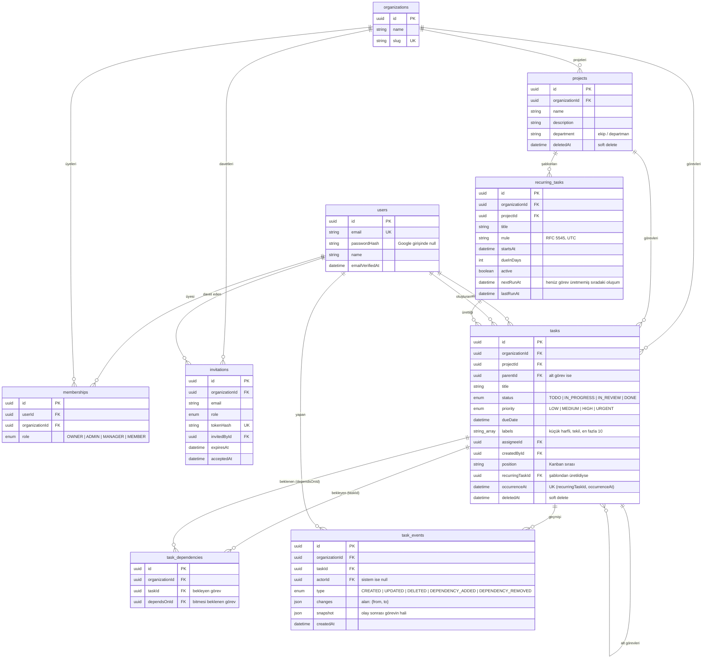

# Veri modeli (ERD)

Kaynak: [apps/api/prisma/schema.prisma](../apps/api/prisma/schema.prisma). Şema değişirse bu diyagram da güncellenir.

## Tasarım kararları

- **Çok kiracılık:** Tenant'a ait her tabloda `organizationId` var. `tasks` tablosunda da (projeden türetilebilse bile) tutuluyor, böylece her sorgu doğrudan tenant ile filtrelenebiliyor ve indekslenebiliyor.
- **Membership ayrı tablo:** Bir kullanıcı birden fazla organizasyonda, her birinde farklı rolle olabilir (çoka çok ilişki + rol).
- **Davet token'ı hash'li:** Veritabanı sızsa bile davet linkleri kullanılamaz.
- **Soft delete:** Projeler ve görevler silinince `deletedAt` dolar; geri alma ve denetim kaydı mümkün olur. Proje silinince görevleri aynı işlemde silinmiş olarak işaretlenir; görev silinince alt görevleri de. Her okuma sorgusu `deletedAt: null` filtresi uygular.
- **Alt görev:** Aynı tabloda `parentId` ile; yalnızca bir seviye (alt görevin alt görevi yok) ve üstüyle aynı projede.
- **Bağımlılık:** `task_dependencies` bir yönlü graf kenarıdır ("taskId, dependsOnId bitmeden başlayamaz"). Döngüsüzlük veritabanı kısıtıyla ifade edilemez; serviste DFS ile ve şirket başına kilit altında denetlenir (ADR-0005).
- **Geçmiş:** `task_events` ekleme-yalnızca (append-only) tablodur. `changes` o olayın değiştirdiğini, `snapshot` olaydan sonraki hali tutar; iki sürümün farkı iki snapshot'tan hesaplanır. Görev soft delete olsa da olaylar kalır (denetim izi).
- **Tekrarlayan görev:** `recurring_tasks` şablondur. Aynı oluşumun iki görev üretmemesi `(recurringTaskId, occurrenceAt)` unique kısıtıyla veritabanı düzeyinde garanti edilir. Şablon silinince üretilmiş görevler kalır, `recurringTaskId` `NULL` olur.
- **UUID kimlikler:** Sıralı sayılar URL'de tahmin edilebilir (`/tasks/1`, `/tasks/2`) ve kayıt sayısını açığa çıkarır.
- **İndeksler:** Kanban ekranının ana sorgusu (`organizationId + projectId + status`) ve şirket genelindeki liste/sayfalama (`organizationId + createdAt`) için birleşik indeksler.
